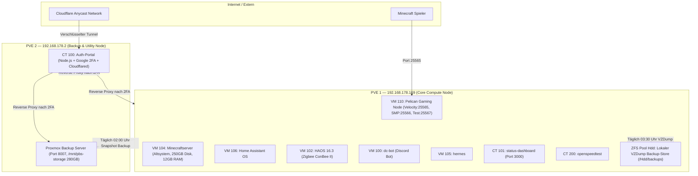
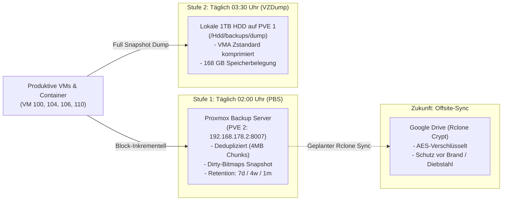
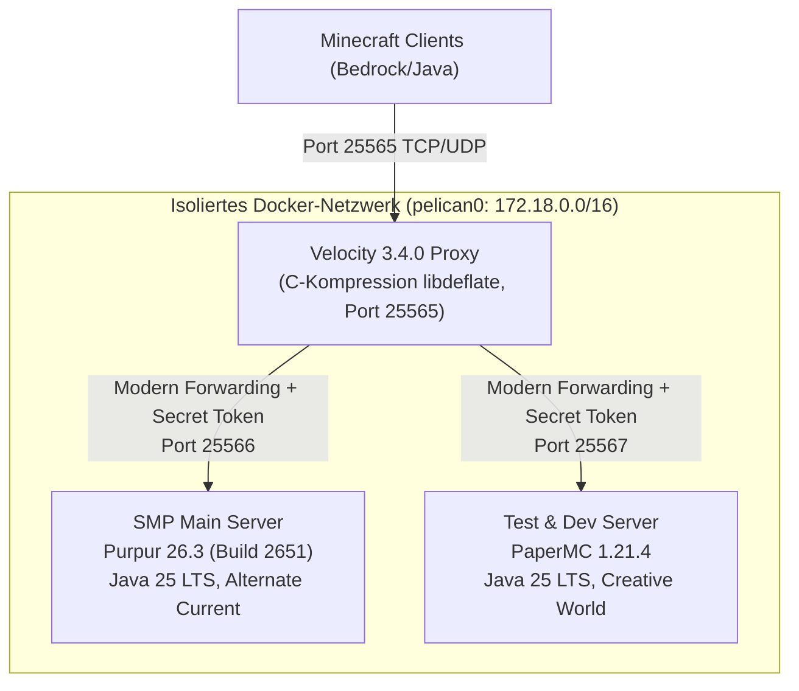
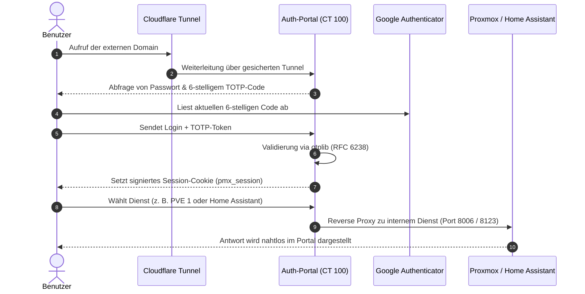
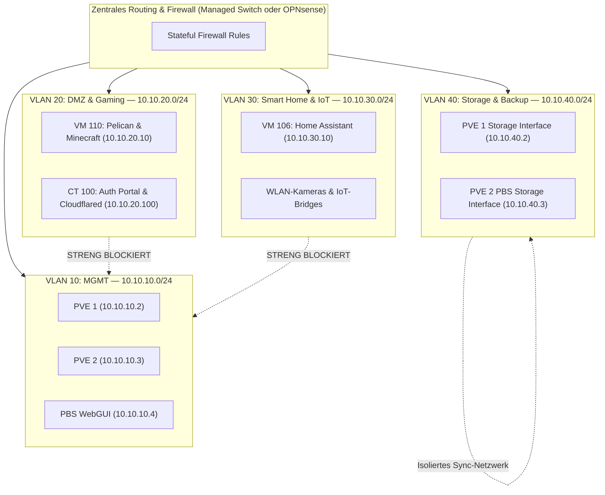

# Proxmox VE Vollständige Systemdokumentation & Architektur-Audit

> **Systemumgebung:** PVE 1 (`192.168.178.169`) & PVE 2 (`192.168.178.2`)  
> **Status:** Produktivbetrieb • Standalone Nodes (kein Cluster)  
> **Datum des Audits:** 17. Oktober 2026  
> **Verfasser:** Antigravity AI Infrastructure Audit  
> **Ablageort:** [PROXMOX_SYSTEM_DOKUMENTATION.txt](file:///C:/Users/han26/Documents/proxmox/PROXMOX_SYSTEM_DOKUMENTATION.txt) / [PROXMOX_SYSTEM_DOKUMENTATION.md](file:///C:/Users/han26/Documents/proxmox/PROXMOX_SYSTEM_DOKUMENTATION.md)

---

## 1. Executive Summary & Schnellübersicht

Die Infrastruktur besteht aus zwei physisch getrennten Proxmox VE-Hosts im lokalen Subnetz `192.168.178.0/24` (Standard-Gateway: FRITZ!Box `192.168.178.1`):



---

## 2. Hardware-, Storage- & System-Status beider Nodes

### 2.1 Node 1: PVE 1 (`192.168.178.169`) — Core Compute Node

* **Betriebssystem:** Proxmox VE 9.1.1 (Kernel `6.17.2-1-pve`, x86_64, Debian 13 based)
* **Prozessor:** AMD Ryzen 5 5600GT with Radeon Graphics
  * **Kerne / Threads:** 6 physische Kerne / 12 logische Threads
  * **Taktung:** Basistakt 3.60 GHz, Boost bis zu 4.65 GHz
  * **CPU Governor:** `performance` auf allen 12 Kernen aktiv
* **Arbeitsspeicher:**
  * **Gesamt:** 30.0 GiB physisch adressierbar
  * **Aktuelle Belegung:** ~21 GiB belegt, 4.0 GiB frei, 6.2 GiB Cache
  * **Swap:** 8.0 GiB (0 Byte Nutzung, kein Swapping)
* **Netzwerk:** Realtek RTL8168h Gigabit Ethernet (`r8169`), Linux Bridge `vmbr0` (`192.168.178.169/24`)
* **Storage-Pools:**
  * `sda` (256 GB SSD): LVM2 Volume Group `pve` (Root-Dateisystem 68 GB, LVM-Thin `local-lvm` 148 GB)
  * `sdb` (1 TB SSD): ZFS Pool `ssd-1tb` (943 GB raw, 486 GB belegt = 51.5 %). Beherbergt alle VMs mit schnellem I/O. ZFS-Scrub fehlerfrei.
  * `sdc` (1 TB HDD): Western Digital WD10JMVW, ZFS Pool `Hdd` (943 GB raw, 18.6 % belegt). Beherbergt den lokalen Backup-Ordner `/Hdd/backups` (`hdd-backup`).
  * `pbs-backup`: Remote-Client-Anbindung an PVE 2 (`192.168.178.2:8007`).

---

### 2.2 Node 2: PVE 2 (`192.168.178.2`) — Backup & Utility Node

* **Betriebssystem:** Proxmox VE 9.2.2 (Kernel `7.0.2-6-pve`, x86_64) mit nativer Proxmox Backup Server 4.2.8 Parallel-Installation
* **Prozessor:** Intel Core i5-7500T @ 2.70 GHz (Kaby Lake, 4 Kerne / 4 Threads, 35W TDP)
  * **Last:** Sehr sparsamer Idle-Betrieb (Load Average ~0.10)
* **Arbeitsspeicher:**
  * **Gesamt:** 7.6 GiB physisch adressierbar
  * **Aktuelle Belegung:** ~1.8 GiB belegt, 5.8 GiB Cache/Puffer
  * **Swap:** 7.6 GiB (nur 4.5 MiB belegt)
* **Netzwerk:** Realtek RTL8168h Gigabit Ethernet (`r8169`), Linux Bridge `vmbr0` (`192.168.178.2/24`)
* **Storage-Pools:**
  * `sda` (480 GB Kingston SA400S37480G SATA SSD):
    * `pve-root`: 96 GB ext4 (nur 9.0 GB belegt = 11 %)
    * LVM-Thin Pool `data` (320 GB raw):
      * `pve-pbs--storage`: 280 GB ext4 Volume gemountet unter `/mnt/pbs-storage` für PBS (72 GB belegt, 201 GB frei)
      * `pve-vm--100--disk--0`: 8 GB Volume für CT 100 (`auth-portal`)

---

### 2.3 Inventar aller virtuellen Maschinen und Container

#### Instanzen auf Node 1 (PVE 1):
| VMID | Name | Typ | Status | vCPUs | RAM | Storage & Größe | IP-Adresse | Funktion / Anmerkung |
| :---: | :--- | :---: | :---: | :---: | :---: | :--- | :--- | :--- |
| **110** | **pelican-server** | VM | Läuft | 10 | 16 GB | `ssd-1tb` (60 GB) | `192.168.178.94` | **Gaming-Zentrale**: Pelican Panel, Wings, Docker, Velocity (25565), SMP (25566), Test (25567) |
| **104** | **Minecraftserver** | VM | Läuft | 6 | 12 GB | `ssd-1tb` (250 GB) | IPv6 / DHCP | **Altsystem vor Pelican-Migration**: Verbraucht 12 GB RAM & erzeugt 61 GB Backups. **Stilllegung empfohlen!** |
| **106** | **homeassistant** | VM | Läuft | 2 | 3 GB | `ssd-1tb` (32 GB) | `192.168.178.93` | Neuere Home Assistant OS VM (Community Scripts), QEMU-Agent aktiv |
| **102** | **haos-16.3** | VM | Läuft | 2 | 3 GB | `ssd-1tb` (32 GB) | `192.168.178.25` | Frühere HAOS-VM mit durchgereiftem ConBee II Zigbee USB-Stick (`1cf1:0030`) |
| **100** | **dc-bot** | VM | Läuft | 1 | 1 GB | `local-lvm` (32 GB) | DHCP | Discord Bot Host |
| **105** | **hermes** | VM | Läuft | 2 | 2 GB | `ssd-1tb` (50 GB) | DHCP | Linux VM |
| **103** | **Pedal** | VM | Stop | 2 | 3 GB | `ssd-1tb` (32 GB) | - | Inaktiv / Archiviert |
| **101** | **status-dashboard** | CT | Läuft | 2 | 1 GB | `local-lvm` (8 GB) | `192.168.178.99:3000` | SLA Uptime, GitHub Heatmap, Ping & Speedtest |
| **200** | **openspeedtest** | CT | Läuft | 2 | 1 GB | `local-lvm` (8 GB) | `192.168.178.44` | Lokaler Netzwerk-Speedtest |

#### Instanzen auf Node 2 (PVE 2):
| VMID | Name | Typ | Status | vCPUs | RAM | Storage & Größe | IP-Adresse | Funktion / Anmerkung |
| :---: | :--- | :---: | :---: | :---: | :---: | :--- | :--- | :--- |
| **100** | **auth-portal** | CT | Läuft | 2 | 1 GB | `local-lvm` (8 GB) | `192.168.178.101` | **Sicherheits-Gateway**: Node.js, Google Authenticator (TOTP), Cloudflare Tunnel Client |
| **Host** | **PBS 4.2.8** | Nativ | Läuft | 4 | 8 GB Host | `/mnt/pbs-storage` (280 GB) | `192.168.178.2:8007` | **Deduplizierender Proxmox Backup Server** für tägliche automatische Sicherungen |

---

## 3. Security-Analyse & Schwachstellen-Audit

### 3.1 Proxmox-Firewall Status
* **Status:** `disabled/running` auf beiden Nodes.
* Die Cluster- und Node-Firewalls sind datacenter-weit deaktiviert (`/etc/pve/firewall/cluster.fw` ist leer).
* **Risiko:** Alle Ports und Dienste auf den Hypervisoren sind uneingeschränkt aus dem gesamten lokalen Netzwerk erreichbar. Ein manipulierter Gast (z. B. kompromittierter Minecraft-Container) kann ungehindert Management-Ports ansprechen.

### 3.2 SSH- und Root-Zugriff
* Beide Nodes erlauben den direkten SSH-Login als `root` mit Passwort-Authentifizierung (`PasswordAuthentication yes`).
* Das Passwort `ep123-washout` ist auf beiden Hosts identisch.
* **Risiko:** Kein Schutz gegen Brute-Force im lokalen Netzwerk (kein Fail2ban auf den Proxmox-Hosts).

### 3.3 2FA-Status auf Hypervisor-Ebene
* In `/etc/pve/tfa.cfg` ist auf **keinem der beiden Proxmox-Knoten** eine Zwei-Faktor-Authentifizierung hinterlegt.
* **Konsequenz:** Wer sich im lokalen Netzwerk befindet, kann `https://192.168.178.169:8006` oder `https://192.168.178.2:8006` aufrufen und sich mit `root` und dem Passwort **ohne jeden 2FA-Code** einloggen. Das Auth-Portal schützt aktuell primär den externen Cloudflare-Zugang, nicht das interne Netz.

### 3.4 Sicherheitsanalyse des Auth-Portals (`CT 100` auf PVE 2)
* Das Auth-Portal (`/opt/auth-portal/server.js`) implementiert den RFC 6238 TOTP Standard (`otplib`) mit Session-Cookies (`pmx_session`).
* > [!CAUTION]
  > **Klartext-Passwort im Dateisystem:**
  > In `/opt/auth-portal/data/config.json` ist das Passwort im Klartext abgelegt:
  > `"plainDefault": "ep123-washout"`. Dieses Feld muss gelöscht werden!
* **Frame-Header Manipulation:**
  In `server.js` werden `x-frame-options` und `content-security-policy` gelöscht, um Web-Oberflächen im Portal-Viewer einbetten zu können. Dies birgt theoretisch Clickjacking-Gefahren, sollte die Session im Browser manipuliert werden.

### 3.5 Risiken des aktuellen flachen Netzwerks (Flat Network)
* Sämtliche Systeme teilen sich das flache Subnetz `192.168.178.0/24`:
  * Hypervisor-Management & PBS
  * Öffentliche Gaming-Services (Minecraft Velocity & Purpur)
  * Smarthome-Geräte (IP-Kameras, Thermostate, Home Assistant)
  * Private Laptops, Smartphones und Gäste-WLAN

---

## 4. Backup-Management & Zukunftsstrategie Google Drive

### 4.1 Ist-Zustand des 2-Stufen-Backups



#### Job 1: Proxmox Backup Server (`pbs-daily-backup`)
* **Zeitpunkt:** Täglich um 02:00 Uhr
* **Ziel:** `pbs-backup` (`192.168.178.2:8007`, Datastore `/mnt/pbs-storage`)
* **Umfang:** VMs 100, 104, 106, 110
* **Methode:** Block-Level Inkrementell via QEMU Dirty-Bitmaps. Nach dem ersten Vollbackup werden nur noch geänderte Blöcke übertragen (Transferzeit meist nur wenige Sekunden bis Minuten).
* **Retention:** `keep-daily=7, keep-weekly=4, keep-monthly=1`
* **Wartung:** Täglich um 04:00 Uhr läuft Garbage Collection auf PVE 2.

#### Job 2: Lokaler VZDump Zstandard-Dump (`local-hdd-daily`)
* **Zeitpunkt:** Täglich um 03:30 Uhr
* **Ziel:** `hdd-backup` (`/Hdd/backups` auf ZFS Pool `Hdd` auf PVE 1)
* **Umfang:** VMs 100, 102, 104, 105, 106, 110
* **Speicheranalyse im Backup-Verzeichnis:**
  * `vzdump-qemu-104-*.vma.zst`: **60.5 GB** (Verbraucht über 36 % des gesamten Backup-Platzes!)
  * `vzdump-qemu-105-*.vma.zst`: **8.7 GB**
  * `vzdump-qemu-100-*.vma.zst`: **5.7 GB**
  * `vzdump-qemu-110-*.vma.zst`: **3.8 GB** (Sehr schlank trotz vollständigem Gaming-Stack)
  * `vzdump-qemu-102-*.vma.zst`: **3.3 GB**
  * `vzdump-qemu-106-*.vma.zst`: **2.3 GB**
  * **Gesamtbelegung:** ~168 GB

### 4.2 Identifizierte Lücken
1. **PVE 2 ist ungesichert:** Weder PVE 2 noch CT 100 (`auth-portal`) oder die PBS-Metadaten werden automatisch gebackupt.
2. **Container ungesichert:** CT 101 (`status-dashboard`) und CT 200 (`openspeedtest`) fehlen in den Backup-Jobs.
3. **Kein Offsite-Schutz (Verstoß gegen 3-2-1-Regel):** Alle Backups lagern physisch am selben Standort. Bei Überspannung, Diebstahl oder Brand sind alle Daten verloren.

### 4.3 Zukunfts-Integration: Google Drive Offsite-Backup
> [!NOTE]
> Proxmox VE und PBS unterstützen proprietäre Google-Drive-APIs nicht nativ. Eine saubere, hochgradig bandbreitenschonende und sichere Integration erfolgt über das bewährte Open-Source-Tool **`rclone`**.

#### Empfohlenes Konzept: PBS-to-Google-Drive Sync mit Rclone Crypt
1. **Installation auf PVE 2:**
   `apt install rclone`
2. **Konfiguration von Google Drive & Verschlüsselung:**
   * Schritt A: Google Drive Remote einrichten (`rclone config` -> `gdrive:`).
   * Schritt B: Verschlüsselten Layer darüberlegen (`rclone config` -> Typ `crypt` -> Remote `gdrive:/pbs-backup-enc`).
   * **Vorteil:** Sämtliche Dateinamen und Inhalte werden auf PVE 2 mit AES-256 verschlüsselt, bevor sie Google erreichen.
3. **Automatisierung nach der Garbage Collection:**
   Ein systemd-Timer auf PVE 2 triggert um 04:30 Uhr morgens:
   ```bash
   rclone sync /mnt/pbs-storage/ gdrive-crypt:/ --fast-list --transfers 4 --bwlimit 15M
   ```
   Da PBS Daten in deduplizierten 4MB-Dateien ablegt, lädt Rclone nur die echten Delta-Chunks hoch (typischerweise nur 200 MB bis 1 GB pro Nacht).

---

## 5. Minecraft-Infrastruktur & Architektur

### 5.1 VM 110: Pelican Gaming Node
* **Host:** VM 110 (`pelican-server`, Ubuntu 24.04 LTS, IP `192.168.178.94`)
* **Ressourcen:** 10 vCPUs (`host`), 16 GB RAM, 60 GB VirtIO-SCSI SSD
* **Verwaltung:**
  * **Pelican Panel:** Moderne PHP 8.3 / Nginx Web-GUI zur Server-Verwaltung.
  * **Datenbank:** MariaDB 10.11.14 lokal auf VM 110.
  * **Pelican Wings Daemon:** Go-basierter Daemon, der Docker-Container orchestriert.

### 5.2 Topologie: Velocity Proxy & Paper/Purpur Backends



* **Velocity Modern Forwarding:**
  Die Backend-Server laufen mit `online-mode=false`, akzeptieren aber dank Modern Forwarding nur Pakete, die das 32-Byte Shared-Secret (`forwarding.secret`) vom Velocity-Proxy mitliefern. Spieler können die Backend-Server nicht direkt anwählen.
* **Leistung & Benchmark-Ergebnisse (aus den verifizierten Tests):**
  * Getestet mit 40 bis 200 gleichzeitigen Bots.
  * **Bis 110–120 Spieler zeitgleich:** Perfekte **20.0 TPS** bei unter 30 ms MSPT.
  * **Bei 60 Spielern:** Lediglich **~20 ms MSPT** (nur 40 % des CPU-Budgets verbraucht). Massive Reserven für Farmen und Redstone.

### 5.3 Altlast: Standalone VM 104 ("Minecraftserver")
* VM 104 (250 GB Disk, 12 GB RAM, 6 vCPUs) läuft weiterhin parallel.
* Sie bindet 12 GB RAM auf PVE 1 und erzeugt jede Nacht 61 GB Backup-Volumen.
* **Empfehlung:** Nach Prüfung von eventuellen Weltdaten stoppen und archivieren.

---

## 6. Authentication mit Google Authenticator (TOTP) & Cloudflare Gateway

### 6.1 Aufbau des Auth-Portals (CT 100 auf PVE 2)
* **Container:** Ubuntu 24.04 LXC, 2 Cores, 1 GB RAM, IP `192.168.178.101`.
* **Dienst:** `auth-portal.service` (`/opt/auth-portal/server.js`) auf Node.js.
* **Ports:** Port 80 (HTTP) und Port 443 (HTTPS).



### 6.2 Funktionsweise des Google Authenticators
1. Ein Base32-Secret (`RYS5KSX6ELQUJE4W2T55UP2L2R23LKKL`) dient als gemeinsamer kryptografischer Schlüssel.
2. Der Google Authenticator errechnet alle 30 Sekunden aus dem Schlüssel und der Unix-Zeit einen 6-stelligen Einmalcode.
3. Das Portal verifiziert diesen Code (`verifySync`) mit einer Toleranz von +/- 30 Sekunden gegen Uhrzeit-Drift.
4. Nach erfolgreichem Login wird ein sicheres Cookie (`pmx_session`) hinterlegt.

### 6.3 Cloudflare Tunnel Anbindung
* Der Daemon `cloudflared.service` stellt eine ausgehende, verschlüsselte Verbindung zu Cloudflare über Port 7844 (UDP/QUIC) her.
* **Vorteil:** Es müssen keine Ports in der FRITZ!Box geöffnet werden; die IP des Internetanschlusses bleibt verborgen.

---

## 7. Architektur-Verbesserungen & konkretes VLAN-Konzept

### 7.1 Soll-Architektur mit 4 isolierten VLANs (IEEE 802.1Q)



### 7.2 Praktische Realisierung im Heimnetz
Da Standard-FRITZ!Boxen kein 802.1Q-VLAN-Tagging auf den LAN-Ports unterstützen, gibt es zwei Wege:

1. **Option A: Smart Managed Switch (Empfohlen, Kosten ~25–35 €)**:
   * Ein 8-Port Managed Switch (z. B. TP-Link TL-SG108E oder Netgear GS308E).
   * PVE 1 und PVE 2 hängen an Trunk-Ports (VLAN 10, 20, 30, 40 tagged).
   * Die FRITZ!Box liefert reines Internet an Port 1.
2. **Option B: Virtuelle OPNsense/pfSense auf PVE 1 (Kostenlos)**:
   * Eine kleine VM auf PVE 1 übernimmt das Routing und die Firewall zwischen den VLANs.
   * `vmbr0` verbindet die FRITZ!Box (WAN), eine interne Bridge `vmbr1` (VLAN-Aware) versorgt alle VMs.

### 7.3 Konfigurationsvorlage für Proxmox (`/etc/network/interfaces`)

```text
auto lo
iface lo inet loopback

iface nic0 inet manual

# VLAN-fähige Hauptbridge
auto vmbr0
iface vmbr0 inet manual
	bridge-ports nic0
	bridge-stp off
	bridge-fd 0
	bridge-vlan-aware yes
	bridge-vids 10 20 30 40

# Management-IP in VLAN 10 (Nur über Admin-PC/VPN erreichbar)
auto vmbr0.10
iface vmbr0.10 inet static
	address 10.10.10.2/24
	gateway 10.10.10.1
	comment "Hypervisor Management PVE 1"

# Dedizierter Storage-Pfad in VLAN 40 (PBS Backup-Verkehr)
auto vmbr0.40
iface vmbr0.40 inet static
	address 10.10.40.2/24
	comment "PBS Backup Interconnect"
```

In Proxmox muss anschließend in den VM-Netzwerkeinstellungen lediglich die gewünschte **VLAN Tag**-Nummer (z. B. `20` für Minecraft) eingetragen werden.

---

## 8. Priorisierte Handlungsempfehlungen (Roadmap)

### Stufe 1: Sofortige Sicherheits-Härtung (Aufwand: ~15 Minuten)
1. **Passwort-Klartext entfernen:**
   In `/opt/auth-portal/data/config.json` auf CT 100 die Zeile `"plainDefault": "ep123-washout"` löschen.
2. **Natives 2FA in Proxmox aktivieren:**
   Im Proxmox Web-GUI unter `Datacenter -> Two-Factor Authentication` TOTP oder WebAuthn für den Benutzer `root@pam` einrichten.
3. **SSH-Schlüssel erzwingen:**
   Passwort-Login in `/etc/ssh/sshd_config` deaktivieren (`PasswordAuthentication no`) und ausschließlich SSH-Keys verwenden.

### Stufe 2: Ressourcen-Bereinigung (Aufwand: ~30 Minuten)
1. **VM 104 stilllegen:**
   Alte Minecraft-VM stoppen. Spart sofort **12 GB RAM**, **6 vCPUs** und **61 GB tägliches Backup-Volumen**.
2. **Home Assistant konsolidieren:**
   Klären, ob VM 102 oder VM 106 aktiv ist, und die inaktive VM stoppen (spart 3 GB RAM und 32 GB SSD-Speicher).
3. **CT 100 & CT 101 in PBS aufnehmen:**
   Den Backup-Job um das Auth-Portal und das Status-Dashboard ergänzen.

### Stufe 3: Zukunfts-Integration Google Drive (Aufwand: ~1 Stunde)
1. `rclone` auf PVE 2 installieren.
2. Verschlüsseltes Google Drive Remote anlegen (`rclone crypt`).
3. Täglichen systemd-Timer um 04:30 Uhr einrichten zur verschlüsselten Synchronisation des PBS-Datastores.

### Stufe 4: VLAN-Segmentierung
1. Managed Switch oder OPNsense-VM einrichten.
2. Proxmox-Bridge auf `bridge-vlan-aware yes` umstellen.
3. Gaming-Stack (VM 110) und Cloudflare-Gateway (CT 100) in die DMZ (VLAN 20) überführen.
