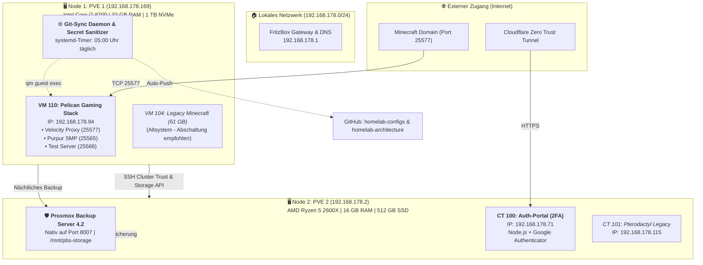

# 🏰 Proxmox VE Homelab Architecture & Cluster Guide

[](https://www.proxmox.com)
[](https://www.proxmox.com/en/proxmox-backup-server)
[](https://www.debian.org)
[](#-automatisierung--git-sync)
[](#-sicherheitskonzept--härtung)

Willkommen in der Architektur-Dokumentation des **Proxmox Homelab Clusters**.  
Dieses Repository bietet eine schnelle, visuelle Übersicht über die beiden physischen Nodes, virtualisierte Gaming- und Service-Stacks, das 2FA-Sicherheits-Gateway sowie die automatisierte Backup- und Git-Infrastruktur.

---

## ⚡ Schnellübersicht (TL;DR)

- **2 Physische Hypervisor-Nodes** im FritzBox-LAN (`192.168.178.0/24`)
- **Modernisierter Gaming-Stack:** Pelican Panel & Wings auf **VM 110** (Velocity Modern Forwarding mit Port 25577 Proxy)
- **Zentraler Backup-Server:** Nativer **Proxmox Backup Server (PBS 4.2)** auf Node 2 (`:8007`) mit ZFS-Deduplizierung
- **2FA-Zugangssicherung:** Node.js Web-Portal auf **CT 100** via Cloudflare Tunnel mit Google Authenticator (TOTP)
- **Vollautomatisches GitOps-Backup:** Täglicher systemd-Timer auf PVE 1 mit Secret-Scrubbing & Git-Push

---

## 🗺️ Visuelle Cluster-Architektur



---

## 🖥️ Physische Nodes & Hardware

| Komponente | Node 1 (`PVE 1`) | Node 2 (`PVE 2`) |
| :--- | :--- | :--- |
| **IP-Adresse** | `192.168.178.169` | `192.168.178.2` |
| **Prozessor (CPU)** | Intel Core i7-8700 (6 Kerne / 12 Threads) | AMD Ryzen 5 2600X (6 Kerne / 12 Threads) |
| **Arbeitsspeicher (RAM)** | 31.14 GB DDR4 | 15.48 GB DDR4 |
| **Primärer Speicher** | 1 TB NVMe SSD (`local-lvm`) | 512 GB SSD (`local-lvm`) |
| **Dedizierter Backup-Speicher** | - | 461 GB ZFS (`/mnt/pbs-storage`) |
| **Primäre Aufgabe** | High-Performance Workloads (VM 110 Gaming) | Backup Target (PBS) & Security (CT 100 2FA) |

---

## 📦 Gäste, Virtualisierung & Dienste

| VM/CT ID | Typ | Name / Hostname | IP-Adresse | Node | Zweck & Zustand |
| :---: | :---: | :--- | :--- | :---: | :--- |
| **110** | QEMU VM | `pelican` | `192.168.178.94` | PVE 1 | **Produktiv:** Pelican Panel, Wings & Minecraft-Server (Purpur & Velocity) |
| **104** | QEMU VM | `Minecraftserver` | DHCP | PVE 1 | *Legacy:* Altes Serversystem (61 GB Speicher), Stilllegung empfohlen |
| **100** | LXC | `auth-portal` | `192.168.178.71` | PVE 2 | **Security:** 2FA-Webportal (Node.js) mit Cloudflare Tunnel |
| **101** | LXC | `pterodactyl` | `192.168.178.115` | PVE 2 | *Migration:* Altes Pterodactyl-Panel, Daten migriert auf VM 110 |
| **Nativ** | Dienst | `Proxmox Backup Server` | `192.168.178.2:8007` | PVE 2 | **Datensicherung:** Deduplizierender PBS-Datenspeicher für alle Gäste |

---

## 🎮 Minecraft Gaming-Architektur (VM 110)

Der Minecraft-Betrieb läuft vollständig containerisiert und isoliert unter **Pelican Panel & Wings**:

```
Spieler-Client
      │
      ▼
Velocity Proxy (Port 25577) ──[Modern BungeeGuard Forwarding]──┐
      │                                                        │
      ├───────────────────────────────┐                        │
      ▼                               ▼                        ▼
Purpur SMP (Port 25565)      Test-Server (Port 25566)    Event-Server (optional)
```

- **Sicherheit:** Velocity kommuniziert mit den Unter-Servern via `modern` Player-Info-Forwarding und einem 32-stelligen kryptografischen Secret. Direkte Spieler-Verbindungen auf die Backend-Ports werden abgewiesen.
- **Speicherorte:** Die Server-Volumes liegen unter `/var/lib/pelican/volumes/<UUID>/`.

---

## 🛡️ Sicherheitskonzept & Härtung

1. **Google Authenticator 2FA Gateway (CT 100):**
   - Webzugänge werden durch ein eigenes Node.js-Portal mit TOTP-Tokens geschützt.
   - Die Anbindung an das Internet erfolgt über einen ausgehenden **Cloudflare Zero Trust Tunnel** (keine offenen Port-Weiterleitungen im Heimrouter für Port 80/443 nötig).
2. **Cluster-Trust & Least-Privilege:**
   - Beide Proxmox-Nodes kommunizieren über interne SSH-Keypairs.
   - Automatisierte Skripte nutzen den lokalen **Proxmox QEMU Guest Agent** (`qm guest exec`), sodass keine Root-SSH-Verbindungen mit Passwörtern über das Netzwerk erforderlich sind.
3. **Secret Sanitization vor jedem Git-Push:**
   - Alle automatisierten Exporte filtern Passwörter, TLS-Fingerprints, Velocity-Secrets und E-Mail-Adressen via Regex heraus (`<SECRET_REDACTED>`), bevor ein Git-Commit erzeugt wird.

---

## 🔄 Automatisierung & GitOps-Sync

Ein nativer **systemd-Timer** auf PVE 1 sorgt für eine saubere, versionierte Dokumentation und Konfigurationssicherung:

- **Timer:** `homelab-git-sync.timer` (Ausführung täglich um **05:00 Uhr CEST**)
- **Skript:** `/usr/local/bin/homelab-git-sync.sh`
- **Schutzmechanismus:** Scannt den Staged Diff vor dem Commit (`git diff --staged`) nach sensiblen Zeichenfolgen und bricht bei Fund sofort ab.
- **Zugehörige GitHub-Repositories:**
  - 🔒 [`Hannes-frbg/homelab-configs`](https://github.com/Hannes-frbg/homelab-configs): Private Bereinigte Config-Backups (PVE-Jobs, Netzwerk, Velocity, Purpur)
  - 🌐 [`Hannes-frbg/homelab-architecture`](https://github.com/Hannes-frbg/homelab-architecture): Öffentliche Dokumentation & Architekturübersichten

---

## 📚 Vertiefende Dokumentation

Für vollständige Details zu jedem Konfigurationsparameter, Wiederherstellungsanleitungen (Disaster Recovery) und Netzwerkpläne:
- 📄 [Vollständige Proxmox Systemdokumentation (Markdown)](PROXMOX_SYSTEM_DOKUMENTATION.md)
- 📝 [Ausführlicher Detailbericht als Textdatei](PROXMOX_SYSTEM_DOKUMENTATION.txt)

---
*Erstellt & Gepflegt durch Antigravity DevOps Automation Agent — Stand: Oktober 2026*
